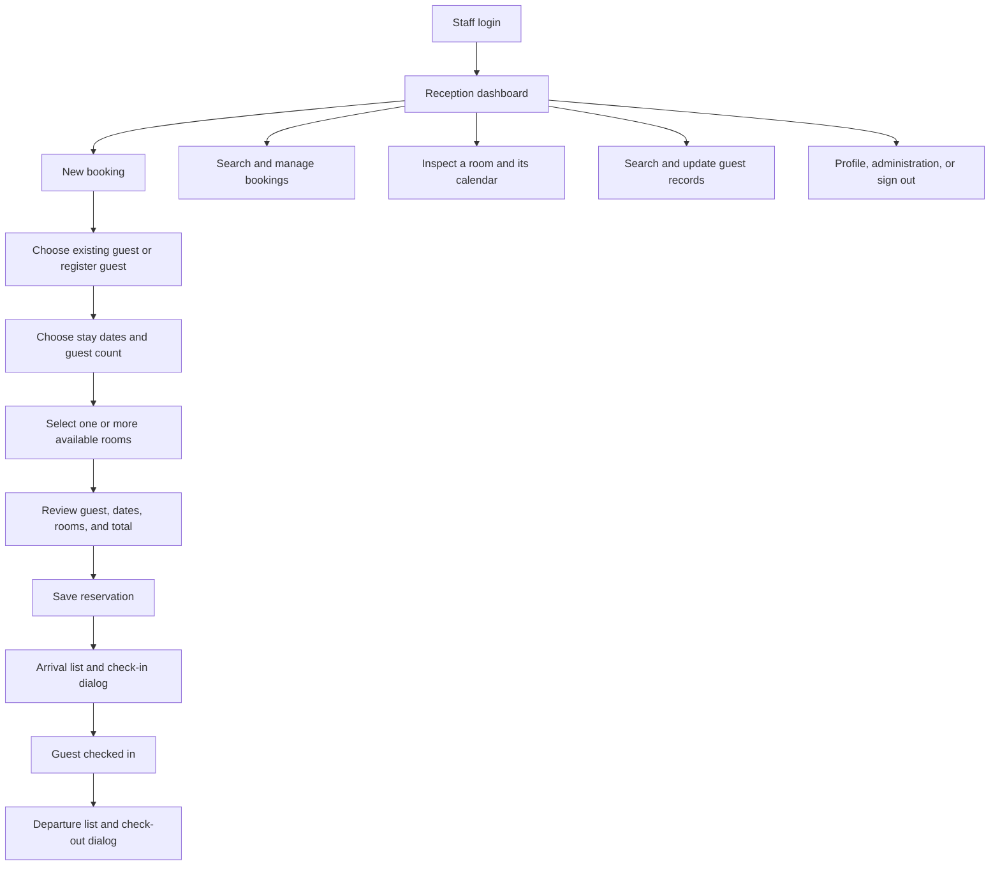
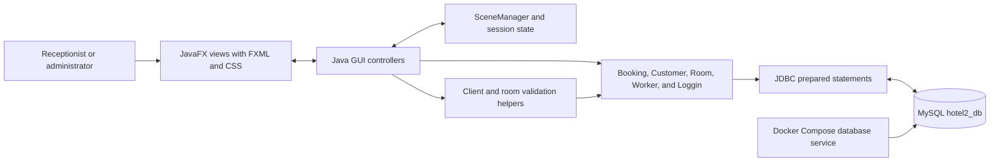

# Hotel2 system and portfolio handoff

Hotel2 is a desktop application for hotel reception staff and administrators. It brings guest records, reservations, room availability, arrivals, departures, and staff administration into one JavaFX interface backed by MySQL. Its main interaction is a monthly calendar that connects the reception overview to individual bookings and rooms.

Use this description as context for improving the project's portfolio presentation. The workflows below describe the implementation in this repository. The later portfolio section proposes presentation changes. The screen descriptions come from FXML, controllers, stylesheets, and the existing background image; they are not a claim that every screen has been verified in a running application.

## Product purpose and users

The central problem is coordinating a guest's stay without repeatedly switching between separate records. A receptionist needs to find or register a guest, choose dates and available rooms, see the price, save a reservation, and later record arrival, departure, and payment status.

The original vision presentation, `Visioner Hotel2.pptx`, describes four goals: fast, simple, pleasant, and stable. These are design goals rather than measured performance results. They explain the prominent actions, bright orange accent, calendar overview, and confirmation dialogs.

| User | Available work |
| --- | --- |
| Receptionist or worker, role `0` | Use the dashboard, manage guests and bookings, inspect rooms, check guests in and out, update their own profile, and sign out. |
| Administrator, role `1` | Perform reception work and open the administration panel to manage staff accounts and the room catalog. |

The settings menu exposes an Adminpanel option to both roles. The controller checks the logged-in role when it is selected and shows an access-denied message for workers. This is an access check in the desktop interface.

## Main user journey



Payment is a separate recorded state and can be marked paid through booking management or the arrival/departure dialogs. The application stores a payment-method label and a paid flag; it does not integrate with a payment processor.

## Functional behavior

### Staff login and profile

Staff log in with a username and password. The login code hashes the entered password with SHA-256, queries the `worker` table, and accepts only an active account with `status = 0`. The session retains the username, user ID, and role for navigation and recording who created a booking.

The profile dialog loads the current user's username and email and accepts a new password. Its update requires all three fields. Signing out returns to the login screen and clears the login fields.

The Agust demo account uses username `agust`, password `agust@hotel2`, email `agust@hotel2.com`, hotel `hotel2`, administrator role `1`, and active status `0`. The email and phone in this account follow the existing demo-data convention.

### Reception dashboard

The dashboard combines a Monday-to-Sunday month calendar with today's arrival and departure lists. Month arrows move through the calendar, and Reset returns to the current month. The current date has a circular marker, and preceding-month cells are gray.

For today and future dates, calendar cells show available-room counts and arrival/departure counts. Available rooms use red for five or fewer, orange for six through fifteen, and green above fifteen. Selecting a day can open its bookings after confirmation, or show a message when it has none.

The two daily lists show room numbers, guest names, and whether payment is recorded. Selecting a row opens the relevant check-in or check-out dialog. Large actions lead to guest management and new bookings; other actions open booking management and room inspection.

### Creating a reservation

1. Choose an existing guest using name/email search, or register a new guest in a modal dialog.
2. Choose arrival and departure dates. The controller checks that arrival is not in the past and does not follow departure; it does not enforce a strictly positive stay length in that comparison.
3. Choose the number of guests and open room selection.
4. Filter rooms by type and bed count, then select one or more rooms. The types offered are All, Standard, and Deluxe. Availability is checked against the chosen stay dates.
5. Review the guest, dates, selected rooms, guest count, and calculated total in the preview area and confirmation popup.
6. Save the booking, including its creator, initial unpaid state, and initial unchecked-in/unchecked-out state. A booking-room link is inserted for each selected room.

The intended total is the sum of each selected room's nightly price multiplied by the number of nights. The current accumulator uses an integer type, so fractional totals can lose precision. Booking creation also checks for overlapping reservations, but this should not be presented as a guarantee against concurrent double booking.

### Booking management

Staff can search by booking ID, guest name, room number, or date in `yyyy-mm-dd` format. Search results appear as selectable rows. Selecting a booking shows its guest, room count, guest count, room details, total, and paid state.

The update action changes guest count and payment status. Existing booking dates and room assignments are not edited through that action. A delete action asks for confirmation and marks the booking inactive instead of removing its historical row. Room rows provide a route to that room's detailed calendar.

### Guest records

Guest records contain first name, last name, email, telephone, and payment method. Staff can create guests, search by name or email, select a result, and update its details. Creation is available both from guest management and while making a booking.

The database requires unique email addresses and telephone numbers for guests. The client-validation layer checks names, email shape, telephone characters, and required fields. Payment choices include Swish, card, and PayPal, with some differences in spelling between the interface and seeded data. There is no guest-deletion action on the main guest-management screen.

### Room inspection and room administration

Room inspection searches by room number and displays room ID, room number, bed capacity, nightly price, type, hotel, and status alongside a monthly room calendar. Calendar entries link back to bookings for that room and show their arrival, stay, and departure dates.

Administrators have a separate room-management form to create, find, select, update, and deactivate rooms. The room catalog stores number, capacity, type, price, hotel, and status. Deletion sets status to inactive; active-room queries normally use `status = 0`. A room's catalog status is distinct from its availability on a particular date.

### Staff administration

The user-management form contains username, email, telephone, role, password, and location/hotel. Administrators can search by name or email, create an account, select an existing account, update it, and deactivate it. The role selector shows Admin and Worker and maps them to `1` and `0`. Deactivation sets `status = 1`, which blocks subsequent login.

## Current visual design

The application opens fullscreen and uses JavaFX desktop controls. Most operational screens are designed around a roughly 1280 by 800 canvas with many controls positioned at fixed coordinates. The interface is mainly Swedish, while some search and role selectors use English.

The background is a symmetrical luxury-hotel lobby image in cream, gold, brown, and dark gray. Main content sits on a white panel with approximately 80 percent opacity, rounded corners, and a dark drop shadow. This creates the effect of a bright floating panel over the hotel interior.


| Visual element | Current treatment |
| --- | --- |
| Main accent | Orange `#f48f0b` for action buttons and the HOTEL2 login title. |
| Main surfaces | White or translucent white; light-gray hover states on result rows. |
| Text and borders | Predominantly black, including button text and thin outlines. |
| Typography | Arimo requested by shared CSS, with Arial and system fonts in some controls. The login title is approximately 96 px. |
| Buttons | Large text, visible borders, about 5 px corner radius, and reduced-opacity orange on hover/press. |
| Result lists | Scrollable columns of white rectangular buttons with black borders and compact record summaries. |
| Dialogs | Separate modal windows for selection, guest creation, confirmation, alerts, profile editing, check-in, and check-out. |

### Screen map

| Screen | Visible structure and interaction |
| --- | --- |
| Login | Centered translucent card; large orange HOTEL2 heading, welcome copy, username/password fields, Logga in and Avsluta actions. |
| Home | Settings gear near the upper left, signed-in user near the upper right, month controls and navigation above a wide calendar, arrival/departure lists below, and large guest/new-booking actions on the lower right. |
| Create booking | Guest and date controls, room selection, guest count, and a booking-preview panel with guest, dates, room count, room list, and total. |
| Choose guest | Search selector, search field, search action, selectable results, and a back action. |
| Choose rooms | Room-type and bed-count selectors above a scrollable room list, with Back and Done actions. |
| Booking preview | A modal containing the booking summary with Back and Done actions. |
| Manage bookings | Search controls and results beside selected-booking details, linked room rows, guest-count/payment controls, and update/delete/create actions. |
| Manage guests | Searchable results paired with a form for first name, surname, email, telephone, and payment method. |
| Room details | Room search and metadata paired with a large month calendar showing that room's bookings. |
| Administration | A left-side choice between room and user management, a large Administration heading, a back action, and a right-side content area. |
| Admin room/user forms | Editable fields on the left, a scrollable result list on the right, search controls below the list, and create/update/delete actions along the bottom. |
| Profile | Compact modal with username, email, new password, and update action. |
| Arrival/departure | Summary of guest, dates, rooms, guest count, total, and payment; a Pay now checkbox and confirm/back actions. |

### Dashboard layout sketch

This is a structural wireframe of the existing layout, not an application screenshot.

```text
+------------------------------------------------------------------------+
| Settings                                           Signed-in username   |
|                                                                        |
| [View rooms]       [Reset]  < Month / Year >       [Manage bookings]     |
| +--------------------------------------------------------------------+ |
| | Mon       Tue       Wed       Thu       Fri       Sat       Sun    | |
| | Date cells: available rooms, arrivals, departures                   | |
| | Click a day to inspect its bookings                                | |
| +--------------------------------------------------------------------+ |
|                                                                        |
| Today's arrivals           Today's departures       [Manage guests]    |
| +----------------------+   +----------------------+                    |
| | Room / guest / paid  |   | Room / guest / paid  |   [New booking]      |
| | Click to check in    |   | Click to check out   |                    |
| +----------------------+   +----------------------+                    |
+------------------------------------------------------------------------+
```

### Administration layout sketch

```text
+------------------------------------------------------------------------+
|                              Administration                   [Back]    |
|                                                                        |
| [Manage rooms]         +---------------------------------------------+ |
| [Manage users]         | Editable fields    | Searchable result list  | |
|                        |                   |                         | |
|                        |                   | Search type / term      | |
|                        | [Update]       [Delete]       [Create]      | |
|                        +---------------------------------------------+ |
+------------------------------------------------------------------------+
```

## Technical architecture



The desktop process talks directly to MySQL. The repository has no HTTP backend, REST API, browser frontend, or cloud service layer. `App` opens a shared connection through `Connector`, launches JavaFX, and closes the connection when the application exits. `SceneManager` changes screens, opens modal windows, and carries session and in-progress booking data.

| Component | Technology and responsibility |
| --- | --- |
| Application | Java 21 toolchain; entry point `hotel2.App`. |
| Interface | JavaFX 21, FXML layouts, Java controllers, and JavaFX CSS. |
| Persistence | MySQL Connector/J 8.0.33 and JDBC prepared statements. |
| Database | MySQL 8.0.36, schema and sample data in `docker/init.sql`. |
| Local infrastructure | Docker Compose exposes container MySQL port 3306 as host port 3307. |
| Build | Gradle wrapper 8.4, application plugin, JavaFX plugin, and toolchain resolver. |
| Test setup | JUnit Jupiter dependency and test-source directory; this does not establish comprehensive automated coverage. |

### Data model

| Table | Main information |
| --- | --- |
| `customer` | Guest identity/contact information and payment-method label. |
| `worker` | Staff login name, password hash, contact information, role, hotel, and account status. |
| `room` | Room number, capacity, type, nightly price, hotel, and catalog status. |
| `booking` | Stay dates, guest reference, payment flag, total, guest count, creator, check-in/out flags, and active/inactive status. |
| `booking_room` | Booking-room pairs, allowing one booking to contain multiple rooms. |

One guest can have multiple bookings. A booking can include multiple rooms, and a room can appear in bookings for different dates. The junction table has foreign keys to booking and room. The guest and booking-creator references are logical relationships without corresponding foreign-key constraints in the current schema. The junction table also has no uniqueness constraint preventing a duplicate room within the same booking.

## Limitations relevant to a portfolio demo

Describe Hotel2 as a desktop project or prototype. Claims about production use, performance improvements, real customers, and personal ownership of particular modules need separate evidence.

- The README documents duplicate room selection, settings-icon rotation problems, and nested modal-window problems on some platforms.
- Resource lookups use `AdminPage.fxml`, `AdminPageManageRoom.fxml`, and `AdminPageManageUser.fxml`, while the actual filenames start with lowercase `admin`. Those mismatches can break classpath loading and should be checked before recording an administration demo.
- Booking creation performs the reservation and room-link writes separately without an explicit transaction. Availability checking and insertion are separate operations, so concurrent reservations need stronger protection.
- Money uses floating-point values in storage and an integer accumulator in the booking preview. A future implementation should use decimal money calculations with explicit rounding.
- Room-size filtering currently queries `roomsize <= selected value`; it should not be described as guaranteed minimum-capacity matching. Guest counts and combined selected-room capacity also need consistent validation.
- SQL failures are often printed and caught without a reliable failure result reaching the interface. Several controller comparisons also use Java string identity rather than content equality.
- Password hashing uses unsalted SHA-256, database connection settings are hardcoded, and role checks are in the desktop client. These are existing demo implementation choices requiring changes before production deployment.
- The bundled bookings use dates in 2024. Today's dashboard can therefore be empty until new sample reservations are made for the demonstration dates.
- Layouts rely on fixed coordinates, font sizes, and many modal windows. Verify the intended display size and popup behavior before collecting screenshots.

## Portfolio presentation direction

### Short project description

Hotel2 is a JavaFX desktop application for hotel reception and administration. It combines guest records, reservations for one or more rooms, room availability calendars, check-in and check-out, and staff management in a single interface backed by MySQL. A calendar-led dashboard connects daily reception work to booking and room details.

### Case study structure

Present the case study in this order: the reception problem, the two staff roles, the main reservation journey, selected screen captures, the desktop/database architecture, and lessons or improvements. Explain what a visible interaction accomplishes before describing its implementation.

Use team-level wording for system features. Add a separate contribution paragraph once Agust has identified the parts he personally designed or implemented. Do not infer individual contributions from this application's functionality or from the new demo account.

### Visual changes to explore

Retain the hotel's warm identity and orange accent while making working surfaces calm and opaque. Give primary, secondary, and destructive actions distinct treatments. Use a consistent text scale and spacing rhythm, and make status text legible without depending on color alone. A persistent navigation area could make returning between dashboard, bookings, guests, and rooms easier.

Explore a clearer separation between today's reception tasks and the longer-term calendar. In reservation creation, keep the selected guest, dates, room choices, capacity, and total visible together. Reduce nested dialogs by keeping common steps in the main window or a single well-defined dialog. These are proposed design changes, not existing features.

### Screenshot and demonstration sequence

1. Show the dashboard with reservations for the actual demonstration date.
2. Choose or create a guest and start a reservation.
3. Select available rooms and show the booking total.
4. Save, search for the reservation, and inspect its details.
5. Check the guest in, then show payment recording and check-out on an appropriate dated reservation.
6. Open a room calendar and follow a booking link.
7. Demonstrate administrator room and user management after checking the resource-loading issue.

Use fictional guest/contact details in public captures. Pair each screenshot with a brief caption about the staff task. The lobby asset is an existing visual reference; it is not a screenshot of a working screen.

### Prompt for the next chat model

```text
Help me turn Hotel2 into a clear portfolio case study and propose improvements
to its visual presentation. Use the attached system handoff as the factual
baseline.

Start with a concise project introduction and a problem/users/workflow story.
Then propose screenshot captions, a case-study outline, and a consistent visual
direction. Preserve the reservation, guest, room, arrival/departure, and staff
administration workflows. Explain why each proposed UI change helps hotel staff.

Keep existing implementation separate from proposed improvements. Hotel2 is a
JavaFX desktop application with direct JDBC access to MySQL. Describe payment
as recorded status, and limit booking editing to what the handoff supports.
Label any browser-based redesign as a new concept if you propose one.

Use team-level wording for the application's capabilities. Ask me which parts
I personally built before writing my individual contribution section. Keep
claims about impact and performance tied to evidence, and treat the original
vision's four qualities as goals. Include a practical screenshot/demo plan.
```

## Source map for follow-up work

| Subject | Repository files |
| --- | --- |
| Startup and navigation | `app/src/main/java/hotel2/App.java`, `GUI/SceneManager.java`. |
| Login and staff data | `com/mid/Loggin.java`, `Worker.java`, `WorkerArrayManager.java`. |
| Dashboard and calendars | `GUI/HomePageController.java`, `DaySquare.java`, `RoomController.java`. |
| Reservations | `GUI/createBookingController.java`, `BookingController.java`, `com/mid/Booking.java`. |
| Guests | `GUI/CreateCustomerController.java`, `com/mid/Customer.java`, `ClientArrayManager.java`. |
| Administration | `GUI/AdminController.java`, `AdminRoomController.java`, `AdminUserController.java`. |
| Screen layouts and styles | `app/src/main/resources/*.fxml`, `app/src/main/resources/css/`. |
| Build and database | `app/build.gradle`, `settings.gradle`, `gradle/wrapper/gradle-wrapper.properties`, `docker/`. |
| Original vision and documented issues | `Visioner Hotel2.pptx`, `README.md`. |

Java paths in this table after the first entry are relative to `app/src/main/java/hotel2/`.
