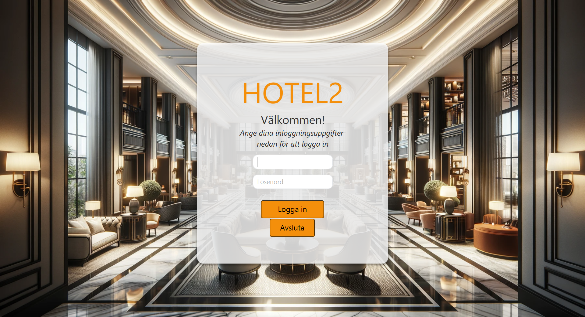
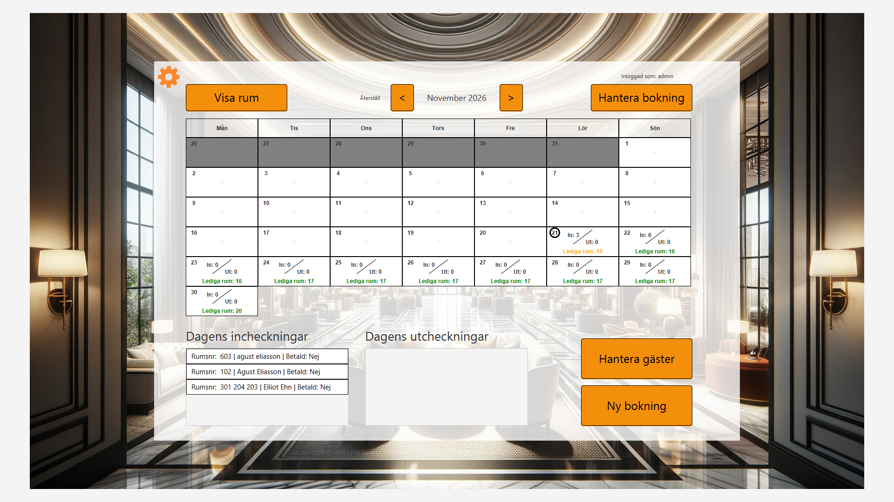
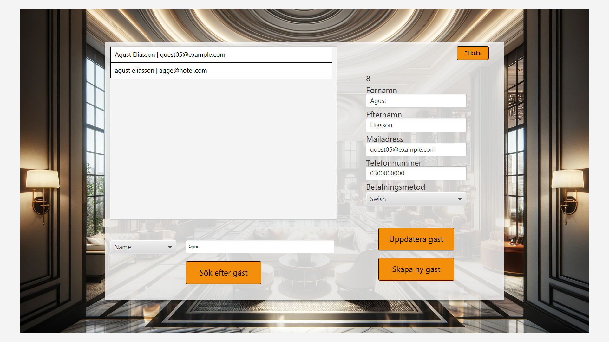
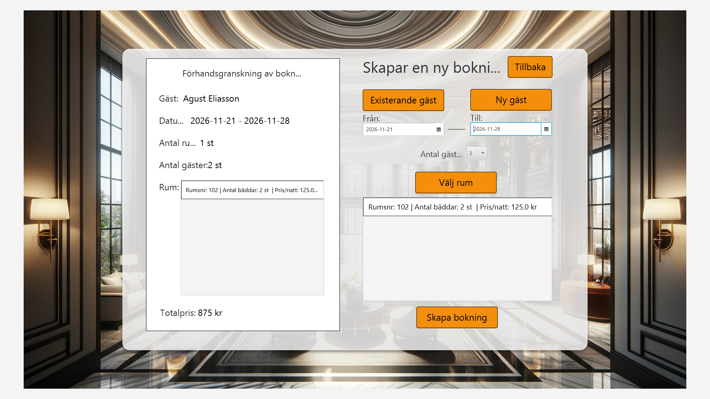
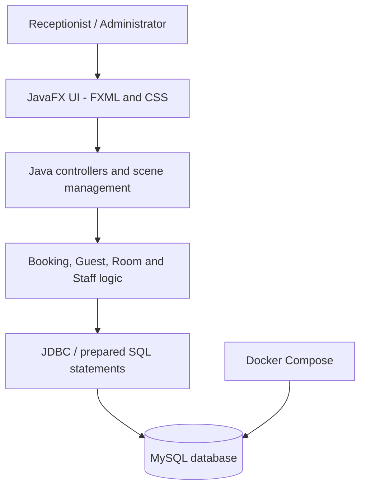

# Hotel2 - Hotel Reception & Booking System

A **JavaFX desktop application** for managing day-to-day hotel reception tasks, including room reservations, guest records, availability, check-in/check-out, and staff administration. The application uses **Java and object-oriented design**, with **MySQL** for data storage and **Docker** for the local database environment.

Built as a university software development project.

## Overview

Hotel2 brings common reception workflows into a single desktop application. Instead of navigating separate records, staff can use a calendar-based dashboard to inspect room availability, manage reservations, and handle arriving or departing guests.

The application supports two user roles:

- **Receptionists:** Manage bookings, guests, room information, arrivals, and departures.
- **Administrators:** Perform reception tasks and manage staff accounts and the hotel room catalog.

## Features

- **Reception dashboard:** Monthly calendar with room-availability information and lists of the day's arrivals and departures.
- **Room reservations:** Select an existing or new guest, choose stay dates, find available rooms, review the calculated price, and save a booking. A reservation can include multiple rooms.
- **Booking management:** Search reservations by ID, guest, room, or date; inspect details; update guest counts and recorded payment status; or deactivate a booking.
- **Guest management:** Register guests, search existing guest records, and update contact and payment-method information.
- **Check-in and check-out:** Handle guest arrivals and departures and record whether payment has been made.
- **Room overview:** Inspect room details and a room-specific booking calendar.
- **Administration:** Allow administrator accounts to manage rooms and staff users.

> **Scope:** Hotel2 is a student desktop application, not a production hotel system. Payment is tracked as a status in the application, it does **not** process transactions through a payment provider.

## Application Screenshots

<table>
  <tr>
    <td width="50%">
      
    </td>
    <td width="50%">
      
    </td>
  </tr>
  <tr>
    <td width="50%">
      
    </td>
    <td width="50%">
      
    </td>
  </tr>
</table>

## Typical Booking Workflow

1. **Sign in** as a receptionist or administrator.
2. **Choose or register a guest** and enter the stay dates and number of guests.
3. **Select available rooms**, optionally filtering by room type and bed count.
4. **Review the reservation**, including selected rooms and the calculated total, then save it.
5. **Manage the stay** from the dashboard or booking search, recording check-in, payment status, and check-out as appropriate.

## Technologies

| Area | Technologies |
| --- | --- |
| Programming language | Java (Java 21 toolchain) |
| Desktop UI | JavaFX 21, FXML, CSS |
| Data access | JDBC, MySQL Connector/J |
| Database | MySQL 8 |
| Build and dependencies | Gradle / Gradle Wrapper |
| Local database environment | Docker Compose |

## Architecture

Hotel2 is a **desktop application that connects directly to a MySQL database**. It does not use a separate REST API or web frontend.



The application uses separate classes for booking, guest, room, and staff operations, with JavaFX controllers handling interaction and navigation. The relational database stores guest and staff records, rooms, bookings, and the links between bookings and rooms.

### Main Database Entities

| Entity | Purpose |
| --- | --- |
| customer | Guest details and contact information |
| room | Room details, type, capacity, price, and status |
| booking | Reservation dates, guests, status, total, and check-in/out information |
| booking_room | Links bookings to one or more rooms |
| worker | Staff accounts and roles |

## Running Locally

### 1 Prepare your computer

- Install **JDK 21** and make sure your terminal can find it. If needed, set `JAVA_HOME` to your JDK installation directory.
- Install **Docker Desktop** and start it, or use Docker Engine with the Compose v2 plugin on Linux.
- Download or clone this repository, then open a terminal in the folder containing `gradlew.bat`, `settings.gradle`, and `docker/`.
- Allow internet access on the first run so Docker can download MySQL and the Gradle Wrapper can download Gradle and the Java dependencies. Separate Gradle and MySQL installations are not required.

Check the prerequisites:

```shell
java -version
docker compose version
```

### 2 Start the database

Run this from the project root on any supported platform:

```shell
docker compose -f docker/docker-compose.yml up -d --wait
docker compose -f docker/docker-compose.yml ps
```

Wait for the first command to finish successfully and for `db` to show as healthy. The first startup initializes `hotel2_db` with sample guests, rooms, bookings, and staff accounts from `docker/init.sql`.

MySQL is available to the desktop application at **localhost:3307**. The host mapping `127.0.0.1:3307:3306` restricts the published database port to your own computer. See [Docker's port-publishing documentation](https://docs.docker.com/engine/network/port-publishing/) for the meaning of this mapping.

### 3 Launch the desktop application

Keep the database running. From the same project-root folder, run:

**Windows PowerShell:**

```powershell
.\gradlew.bat run
```

**macOS or Linux:**

```bash
chmod +x gradlew
./gradlew run
```

The JavaFX login window opens as a desktop application. Keep the terminal open while using it. Most interface labels are in Swedish.

### 4 Sign in with a demo account

Use a **username**, rather than an email address, in the login form:

| Role | Username | Password |
| --- | --- | --- |
| Receptionist | `reception` | `toor` |
| Administrator | `admin` | `Admin` |
| Administrator | `agust` | `agust@hotel2` |

For example, enter `agust` and `agust@hotel2`, then click **Logga in**. Passwords are case-sensitive, including the capital `A` in `Admin`.

These are intentionally public credentials for the local demonstration database only. They must not be reused for real deployments.

### 5 Try the main workflows

1. Open **Hantera gäster** and choose **Skapa ny gäst**. Enter a first name, surname, unique email and telephone number, and a payment method. For example, use `Demo`, `Guest`, `demo.guest@example.com`, and `0700000001` if those contact details have not already been registered.
2. Return to the dashboard and select **Ny bokning**. Choose the guest, current or future stay dates, guest count, and an available room, then review and save the booking.
3. Open **Hantera bokning** to find the reservation. A booking starting today also appears in today's arrivals, where you can try check-in.

The bundled bookings use dates in 2024, so today's arrival and departure lists may initially be empty. Create a booking for your demonstration dates to populate them.

### 6 Stop the application and database

Close the Hotel2 window, then run from the project root:

```shell
docker compose -f docker/docker-compose.yml stop
```

This keeps the stopped container and its current demo data for the next run. Start it again with the command in step 2.

### Startup troubleshooting

| Problem | What to check |
| --- | --- |
| Docker cannot connect to its daemon | Start Docker Desktop or the Docker daemon, then retry the database command. |
| Port `3307` is already in use | Another database may already be running on that port. Use one database instance at a time. The port in `Connector.java` must match the host port in the Compose file. |
| Java is missing or the build reports a Java version error | Check `java -version` and point `JAVA_HOME` to JDK 21, then open a new terminal. |
| The application cannot connect to MySQL | Check that `db` is healthy with `docker compose -f docker/docker-compose.yml ps`. Inspect startup errors with `docker compose -f docker/docker-compose.yml logs db`. |
| Agust's login is missing from an older database | Use `admin` / `Admin`, or apply the supplied `docker/add-agust-admin.sql` update to add Agust. Initialization scripts run only for a fresh database. |

## Development Context and My Contributions

This project was developed as a student application. The features above describe the **system as a whole**.

My main contributions were:

- Implemented backend application logic for hotel reception and management workflows.
- Developed object-oriented Java classes to organize application data and behavior.
- Contributed to database features supporting persistent storage in MySQL.
- Implemented input validation for email addresses, phone numbers and other user inputs.

## Limitations and Possible Improvements

As a university prototype, Hotel2 has areas that could be strengthened for production use:

- **Reservation consistency:** Use database transactions and stronger concurrency controls around room availability and booking creation.
- **Financial calculations:** Use decimal arithmetic and consistent rounding for reservation totals.
- **Security:** Improve password storage, configuration handling, and server-side authorization before use with real users or data.
- **Desktop usability:** Refine fixed-size layouts and modal interactions for different screens and operating systems.

#### Developed for the **1DT908 "Mjukvaruutvecklingsprojekt"** Standard level course at Linnaeus University, fall 2023.